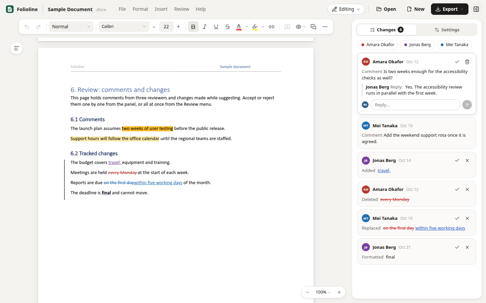
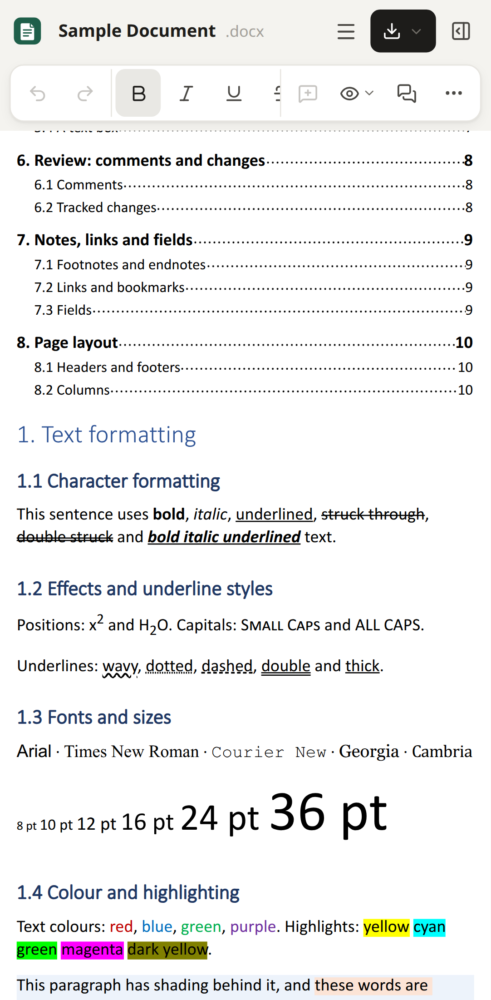
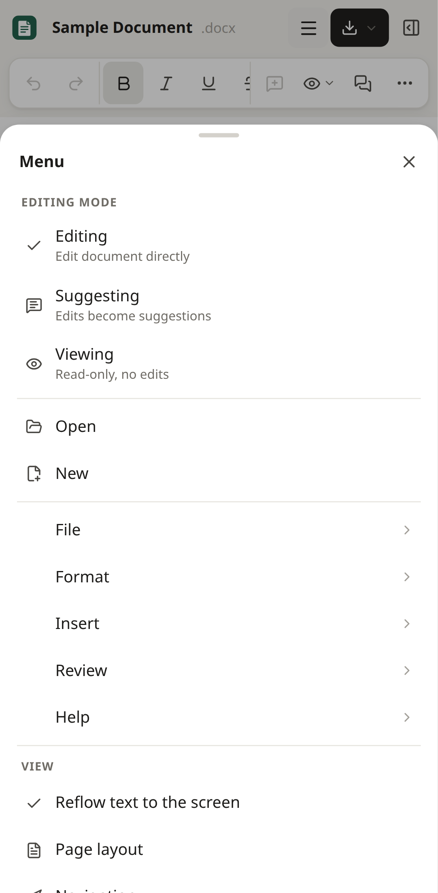

# Folioline

Folioline is a Word (DOCX) editor for desktop and mobile that runs in the browser: a title bar
with File, Format, Insert, Review and Help menus, a floating toolbar with a More panel, Editing,
Suggesting and Viewing, a Changes panel with reviewer filters, Display for Review, a navigation
pane, headers and footers edited in place, watermarks, a table of contents, forms protection, the
Page Setup, Paragraph, Watermark and Track changes dialogs, a `ref.save()`-style page handle and
an Office.js-shaped batch API, in twelve interface languages, on its own engine. On phones it
reflows the text and puts the toolbar, More and every menu in bottom sheets, and it works over a
plain HTTP address on the local network. PDF and Markdown are written in the browser, and live
sessions run on a small relay built into the dev and preview servers.

It comes as a React component and a Vue component, each written natively for its framework on one
shared engine, in a pnpm monorepo: `@folioline/core` (the engine, the page API and the interface
state), `@folioline/react`, `@folioline/vue`, `@folioline/relay` (the live-session relay), and the
full-page app built once with each component.

Its features are listed area by area in [docs/feature.md](docs/feature.md).

| Desktop | Phone | Phone menu |
| --- | --- | --- |
|  |  |  |

## Run

```bash
git clone https://github.com/mas-ony/office-folioline.git
cd office-folioline
pnpm install
pnpm dev             # the React app: http://localhost:5178, also on the LAN address Vite prints (open it on a phone)
pnpm dev:vue         # the Vue app: http://localhost:5184
                     # the sample document opens first; another example: /?example=agreement
                     # (template, long, tables, international, formatting); a file: /?src=/examples/template.docx
                     # an empty document: /?new=1
pnpm build           # the packages into packages/*/dist, the apps into apps/web-react/dist and apps/web-vue/dist
                     # (installable PWAs when served over HTTPS)
pnpm build:npm       # the React app without source maps in npm/dist, for the npm package
pnpm preview         # serve the React app's build on port 4178, with the live-session relay
pnpm preview:vue     # serve the Vue app's build on port 4184, with the live-session relay
pnpm test            # unit tests of all packages (pandoc and pdftotext are used for cross-checks when installed)
pnpm test:e2e        # Playwright against both apps, desktop and Pixel 7 profiles (Chrome at /usr/bin/google-chrome or $CHROME_PATH)
pnpm typecheck
pnpm fixtures        # regenerate the test documents in packages/core/tests/fixtures and the examples in apps/web-shared/public/examples
```

`E2E_BASE_URL=http://<LAN address>:5178 E2E_VUE_URL=http://<LAN address>:5184 pnpm test:e2e` runs
the browser tests against plain HTTP addresses, which are insecure contexts like a phone on the
local network (no clipboard API, service workers, file pickers or share sheet). The editor
feature-detects all of these.

To edit together, open **Settings › Start a live session**: the document is uploaded to the relay
that the dev and preview servers serve under `/collab`, and the panel shows an invite link
(`/?room=<id>`) and a QR code to open it on another device on the same network. Rooms live in the
server's memory until it stops or nobody has used them for 12 hours; a static copy of a build
served elsewhere has no relay and cannot start a session.

## What works

- **Files**: Open (button, File menu, Ctrl+O, drag and drop, `?src=`, the OS "Open with" of the
  installed app), New, File › Examples (seven documents written for this project), an editable
  document name, Export › Word document, PDF and Markdown, Print, recovery of unsaved work from
  IndexedDB, and an explanation with an error code when a file does not open. The saved DOCX
  keeps what the editor does not change: styles, numbering, sections, headers and footers,
  comments with replies, tracked changes, fields, notes, images, text boxes, watermarks and
  unknown XML.
- **Title bar and menus**: File (Open, Examples, Save, Export, Print, Page
  setup), Format (character formatting, alignment, text direction, line spacing options, format
  painter, clear formatting), Insert (image, text box, table size grid, footnote, endnote, page
  and section breaks, table of contents, bookmark, go to bookmark, watermark), Review (Display for
  Review, track changes options, previous and next change, accept or reject all shown, paragraph
  marks, bookmarks, Protect Document for Forms, Markup Options › Reviewers) and Help (report an
  issue, keyboard shortcuts, about); the Editing, Suggesting and Viewing pill.
- **Toolbar**: undo and redo, paragraph style, font family with search and groups, size stepper,
  bold, italic, underline, strikethrough, font colour (theme colours with tints and shades,
  standard and custom) and highlight, link, alignment, comment, Display for Review and Show
  comments; groups that do not fit move into More, together with the contextual Table (borders,
  border colour, style and width, cell fill, merge, split and more) and Picture (properties, text
  wrapping, alt text, rotate and flip) groups.
- **Review**: comments on a selection (toolbar, right-click menu, a button beside the selection
  or Ctrl+Alt+M) with replies, resolve, reopen and delete; Suggesting records insertions,
  deletions and formatting per author; the Changes tab lists comments and changes with accept and
  reject, reviewer chips hide a reviewer's markup; Simple Markup, All Markup, No Markup and
  Original; Track changes options with insertion, deletion, changed-line and table-cell styles;
  comment cards beside the pages.
- **Navigation pane** with headings, find (match case, whole words, result list, replace one or
  all) and bookmarks; a **right-click menu** with clipboard, formatting, link, comment and table
  actions; **rulers** (Settings) with draggable margins and indents; a **zoom pill** (Automatic,
  Fit width, 25–200%, Ctrl+wheel) and a page indicator.
- **Pages**: pagination with sections and columns, headers and footers edited in place with an
  Options menu (page fields, different first page, different odd and even pages, link to
  previous, distances, remove), page numbers in the text, footnotes and endnotes, tables split
  across pages, floating pictures with every wrapping style, text boxes, shapes and groups of
  shapes and pictures, watermarks, a table of contents that updates, forms protection,
  right-to-left text and CJK.
- **Dialogs**: Page Setup, Paragraph (indents, spacing, pagination, tab stops), Watermark,
  Track changes options, Bookmark, Image properties, alt text, link, split cell, notes, text box.
  Lengths in the dialogs, on the rulers and in the header Options menu are in centimetres, or in
  inches where the browser's language is US English (or English with no region).
- **Exports in the browser**: PDF with embedded font subsets, selectable text and links (words in
  right-to-left, complex and CJK scripts are drawn as images); Markdown with headings, lists,
  tables, links and footnotes.
- **Live sessions**: real-time editing with others through a link or QR code, with everyone's
  cursors and shared comments.
- **Settings**: your name for comments and changes, light or dark appearance (pages shown
  inverted), rulers and the interface language: English, Polish, German, French, Japanese,
  Spanish, Portuguese (Brazil), Hebrew (right to left), Hindi, Indonesian, Turkish and Chinese
  (Simplified).
- **Phones**: text reflowed to the screen (page layout on demand), a toolbar row that scrolls and
  starts with formatting, More, menus, the review panel and dialogs as bottom sheets, and a menu
  with the editing modes, the menu bar, the view and the navigation pane. Native selection,
  keyboard, autocorrect and IME.

## Programming interface

### Components

`@folioline/react` and `@folioline/vue` each export a `FoliolineEditor` component and a `mount()`
function, with the same options. Import the package's `style.css` once (the fonts and the
editor's styles). The editor fills its container, so give the container a height.

```tsx
import { FoliolineEditor } from '@folioline/react';
import '@folioline/react/style.css';

<div style={{ height: '80vh' }}>
  <FoliolineEditor
    document="/contracts/lease.docx"
    user={{ name: 'Jordan Lee' }}
    examples={[{ id: 'template', url: '/examples/template.docx', label: 'Template' }]}
    onReady={(editor) => editor.on('change', ({ dirty }) => console.log('unsaved changes:', dirty))}
  />
</div>
```

```vue
<script setup lang="ts">
import { type ColorScheme, type DocxEditorRef, FoliolineEditor, type UserInfo } from '@folioline/vue';
import '@folioline/vue/style.css';
import { ref } from 'vue';

const user = ref<UserInfo>({ name: 'Jordan Lee' });
const scheme = ref<ColorScheme>('light');
const onReady = (editor: DocxEditorRef) => editor.setMode('suggesting');
</script>

<template>
  <FoliolineEditor style="height: 80vh" document="/contracts/lease.docx"
    v-model:user="user" v-model:color-scheme="scheme" @ready="onReady" />
</template>
```

```js
// Without writing React or Vue code (either package)
import { mount } from '@folioline/vue';
import '@folioline/vue/style.css';

const editor = mount(document.querySelector('#editor'), { document: file, locale: 'de' });
const handle = await editor.ready;
editor.update({ colorScheme: 'dark' });
editor.destroy();
```

Options, the same props in both components (`FoliolineOptions` in
`packages/core/src/ui/types.ts`):

| Option | |
| --- | --- |
| `document` | A URL, Blob, ArrayBuffer or bytes, or `{ url or data, name }`; opened again when it changes |
| `examples` | Documents for File › Examples (`{ id, url, label, name }`); no Examples menu without them |
| `locale` | One of the twelve interface languages (`'en'`, `'de'`, `'he'`, `'zh-CN'`…); by default the stored one or the browser's |
| `user` | The name on comments and tracked changes; by default the stored name or a generated one |
| `colorScheme` | `'light'` or `'dark'` |
| `storageKey` | Keep the reader's settings (name, language, appearance, rulers, side panel and markup options) in localStorage |
| `autosave`, `offerRecovery` | Keep unsaved work in IndexedDB and offer to recover it |
| `relay`, `shareLink`, `room` | Live sessions: the relay's URL (default `/collab`), the invite link for a room, a room to join at start |
| `files` | Replace some of the file actions (New, Open, the examples, Save as Word document, PDF and Markdown export, Print, Share) |
| `globalShortcuts` | Handle Ctrl+F and Ctrl+Shift+E anywhere on the page |

Events: `onReady(editor, ui)`, once the first document (or live session) has opened, with the
editor's page handle and the interface's state and actions (`FoliolineUI`); `onUserChange`,
`onLocaleChange` and `onColorSchemeChange` when the reader changes them in the interface. In Vue
they are `@ready`, `@update:user`, `@update:locale` and `@update:colorScheme`, so `v-model:user`,
`v-model:locale` and `v-model:color-scheme` work.

The interface keeps its classes on its own element and on a layer it adds to the page's body for
menus, dialogs and messages (`fl-` for the interface, `dx-` for the document). It changes nothing on
`<html>` or `<body>` (apart from a class while printing, which also lifts any height limit or
clipping set on them), and several editors can share a page.

Live sessions need the relay on the server that serves the page:

```js
// vite.config.ts: serves /collab from `vite` and `vite preview`
import { collabRelay } from '@folioline/relay';
export default defineConfig({ plugins: [vue(), collabRelay()] });

// Any Node server (node:http, Connect, Express)
import { createRelayMiddleware } from '@folioline/relay';
app.use(createRelayMiddleware({ base: '/collab' }));
```

### Page API

`installPageApi(editor)` from `@folioline/core` puts an editor's page handle on the page, as the
apps do once the first document (or live session) has opened. `window.docxEditor` is a ref-style
handle to the editor, and `window.DocxEditorAPI` an Office.js-shaped batch runtime
(`packages/core/src/api/page.ts`, `packages/core/src/api/officeApi.ts`):

```js
const buffer = await docxEditor.save();                // ArrayBuffer of the .docx
await docxEditor.load(bytes, 'Contract.docx');         // ArrayBuffer, Uint8Array, Blob or 'blank'
docxEditor.setMode('suggesting');                      // 'edit' | 'suggesting' | 'view'
docxEditor.exec('bold');                               // → { ok: true }
docxEditor.exec('insertTable', { rows: 3, cols: 2 });
docxEditor.on('change', ({ dirty }) => console.log(dirty));
const state = docxEditor.snapshot();                   // mode, markup, zoom, pages, selection, counts
const pdf = await docxEditor.exportPdf();              // Uint8Array, made in the browser
const md = docxEditor.exportMarkdown();

await DocxEditorAPI.createBrowser().run(async (context) => {
  const hits = context.document.body.search('within 7 days', { matchCase: true });
  hits.load('items');
  await context.sync();
  hits.items[0].insertText('within 30 days', 'Replace').font.bold = true;
  context.document.body.paragraphs.getFirst().insertParagraph('Draft', 'After');
  await context.sync();                                // applied all or nothing
});
const server = await DocxEditorAPI.createServer(bytes, { author: 'Robot' }); // no page needed
```

`docxEditor.getEditor()` returns the native editor (`DocxEditor`,
`packages/core/src/editor/DocxEditor.ts`).

## Tests

- 172 unit tests (Vitest). In `@folioline/core`: XML, import, export and round trips of six test
  documents and the seven examples (each also compared through pandoc), footnotes and endnotes,
  fields, review features (comments, suggesting, markup modes, hidden reviewers, formatting
  tracking, search, list styles, table actions, bookmarks and cross-references, footnote editing,
  copy formatting), the sample document, Markdown export and escaping, watermarks, the table of
  contents, splitting cells and borders, forms protection, picture wrapping, shapes and groups
  (theme colours, outlines, text in a group, copy and paste, vector paths in PDF files), page setup,
  paragraph settings, text boxes, paragraph spacing CSS, interface text formatting, the completeness
  of all eleven translations, the PDF writer and fonts (text checked with pdftotext), the header and
  footer distances typed in the Options menu, lengths in inches and centimetres in the dialogs, and
  both programming interfaces. In `@folioline/relay`: rooms, two simulated clients editing at once,
  late joiners and another base path. In `@folioline/react` and `@folioline/vue`, the same scenarios
  for `mount()`: opening a document with a dark appearance and cleaning up, Settings reporting a new
  name and dialogs in the layer, two editors on one page, and Replace all using the query just typed
  before its search has run.
- 72 end-to-end tests (Playwright), the same 36 against the React app and the Vue app: 27 desktop
  (the sample with its review panel and page fields, toolbar formatting, menus and the table grid,
  comments with replies and resolve, suggestions accepted and rejected, Display for Review and
  reviewer filters, the navigation pane with find, replace and bookmarks, the Page Setup, Paragraph
  and Watermark dialogs, the Page Setup and Paragraph dialogs in centimetres for a British English
  browser, a dialog opened from the toolbar's More panel, a click on a square-wrapped picture over
  the paragraph that wraps around it, shapes and a group of a picture, a text box and a line drawn
  on the page and in the PDF, printing every page with no blank one after the last, a picture
  wrapped top and bottom at its offset and aligned right (still aligned after its dialog is applied
  again), header editing with page numbers, the header Options menu (page X of Y, distances, a
  different first page, linking a section to the previous one), Word, PDF and Markdown export,
  settings with name, dark appearance, German and Hebrew, zoom and the narrow-window toolbar, the
  examples, the table right-click menu, the page API, dragging a margin on the ruler, a footnote
  inserted and edited in its dialog, template fields filled under forms protection and two people
  editing in real time) and 9 phone (Pixel 7: tap and type in reflowed text, a tap through the
  message at the bottom of the screen, the scrolling toolbar and the More sheet, the menu sheet with
  modes, review and page view, an example opened from the menu sheet with its pages scaled to the
  screen, comments in the review sheet, Word and PDF export from the menu sheet and Word export from
  the Export menu, find in the navigation sheet). The suite also passes over plain HTTP LAN
  addresses.

## Layout

| Path | Contents |
| --- | --- |
| `packages/core` | `@folioline/core`, everything the two interfaces share |
| `packages/core/src/core` | DOCX package (`ooxml/`), XML parser and serializer (`xml/`), document model and ProseMirror schema (`model/`, with watermarks, text boxes and drawings), import (`import/`) and export (`export/`, with Markdown), blank documents |
| `packages/core/src/editor` | The editor (`DocxEditor.ts`): commands, keymap, node views, pagination (`layout/`), headers and footers, notes, fields, bookmarks, table of contents, table formatting, pictures, paragraph settings, markup display, forms protection, plugins for comments, tracked changes, presence, numbering, search and table styles |
| `packages/core/src/ui` | The interface without a framework: its state and actions (`controller.ts`, `FoliolineUI`), the editor's state for the views (`store.ts`), the commands, menus, toolbar layout, review cards, colour palettes and dialog values, autosave, options and types |
| `packages/core/src/styles` | Fonts, document styles (`editor.css`) and interface styles (`ui.css`) |
| `packages/core/src/i18n` | Interface strings: English (`en.ts`) and eleven translations (`locales/`), plural rules |
| `packages/core/src/api` | Page handle (`page.ts`), Office.js-shaped batch API (`officeApi.ts`) and document sources |
| `packages/core/src/pdf` | PDF export: font reader and subsetter (`sfnt.ts`), PDF writer, collector of the laid-out pages |
| `packages/core/src/collab` | Live session: sends and receives editing steps, comments and cursors |
| `packages/core/tests` | Unit tests and test documents (`fixtures/`, generated by `scripts/make-fixtures.mjs`, plus a pandoc sample); to rebuild the pandoc sample from `sample.md`, run `SOURCE_DATE_EPOCH=1704067200 pandoc sample.md -o pandoc-sample.docx` in `fixtures/` (the fixed date makes repeated runs give the same file) |
| `packages/react` | `@folioline/react`: `FoliolineEditor` and `mount()`; title bar and menus, toolbar (`format/`), side panel and review cards, comment cards beside the pages, navigation pane, rulers, zoom, right-click menu, dialogs (`dialogs/`), phone menu |
| `packages/vue` | `@folioline/vue`: the same in Vue single-file components (`controls/`, `format/`, `review/`, `nav/`, `dialogs/`) |
| `packages/relay` | `@folioline/relay`: live-session relay, as a Vite plugin or Node middleware |
| `apps/web-react` | The full-page app in React |
| `apps/web-vue` | The same app in Vue |
| `apps/web-shared` | What both apps share: `src/shell.ts` reads the address, lists the examples, keeps the settings and unsaved work, sets the window title and the page's language, opens dropped files and installs the page API; `src/app.css` has the page styles; `public/` has the icons, manifest, service worker and example documents (generated by `scripts/make-fixtures.mjs`); `vite/assetLicenses.ts` completes the builds' licence files |
| `tests/e2e` | Playwright tests, run against both apps (one opens the `drawings.docx` test document) |
| `scripts` | Test documents and examples (`make-fixtures.mjs`) |
| `npm` | The npm package `folioline` (the built React app): its manifest, README and licence. Packing or publishing it there (`pnpm pack`, `npm publish`) runs `pnpm build:npm` first, and the package holds only `dist` |

## Known gaps

- The packages in `packages/` are not published to npm yet (they are marked private); another
  project can use them from this workspace or from `pnpm pack` archives.
- Live sessions need the relay (in the dev and preview servers, or `@folioline/relay` on another
  server); rooms live in memory, anyone who can reach the server with the link can join, and
  headers, footers and footnotes cannot be edited while a document is shared.
- Fonts that are not installed are replaced with metric-compatible open fonts, and the browser
  shapes the text, so line breaks can differ slightly from Word.
- In multi-column sections a paragraph moves to the next column as a whole; a footnote taller
  than the space left on its page is not continued on the next page; very long documents are laid
  out in full, without page virtualisation.
- Text boxes are shown with their fill and border but their text is edited in a dialog;
  equations, charts and SmartArt are kept unchanged and shown as placeholders.
- Shapes, groups and drawing canvases are drawn but cannot be edited or moved. Like floating
  pictures, they are placed from their paragraph and column, so positions measured from the page or
  its margins come out shifted; shadows, glows and 3-D effects are not drawn.
- Track changes options apply to the display; the editor records insertions, deletions and
  formatting, not moves.
- In PDF files, words in right-to-left, complex and CJK scripts are pictures, not selectable text.
- The batch API covers the parts listed above, not the whole Office.js Word object model.

## License

MIT ([LICENSE](LICENSE)). Each package in `packages/` and the npm package in `npm/` carry a copy,
with their own README for npm. The app builds write `THIRD-PARTY-LICENSES.md` next to the app,
listing the bundled packages, icons and fonts with their licences
(`apps/web-shared/vite/assetLicenses.ts` adds the fonts, which come in through CSS, and the notice
from the top of qrcode-generator's script, since that package has no licence file); the fonts come
from the `@fontsource` packages under the SIL Open Font License 1.1.
